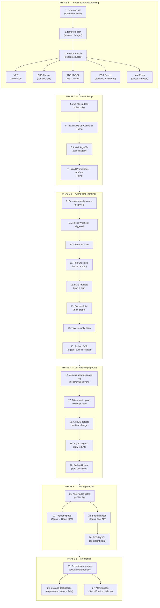
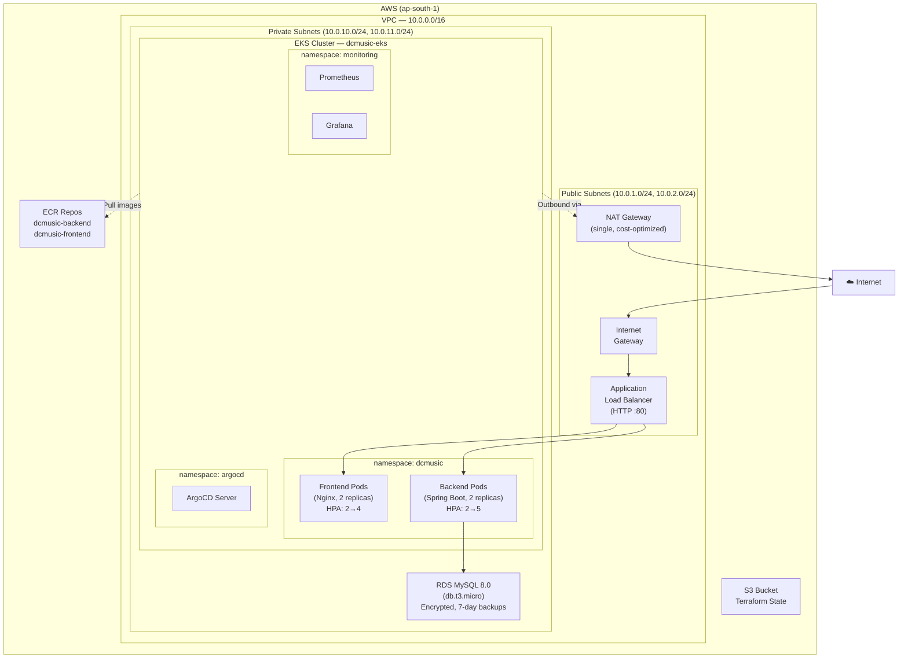
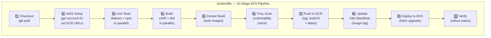
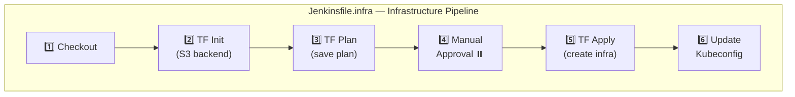
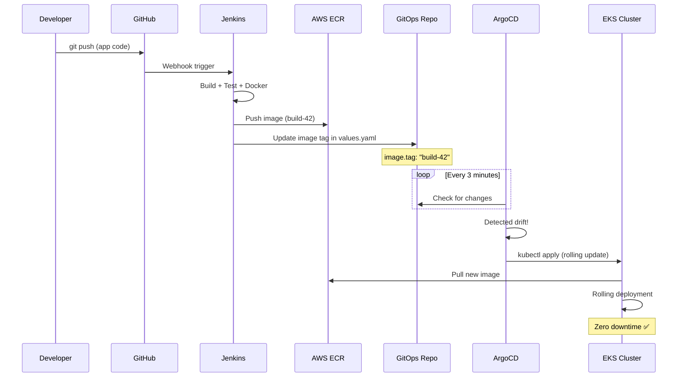
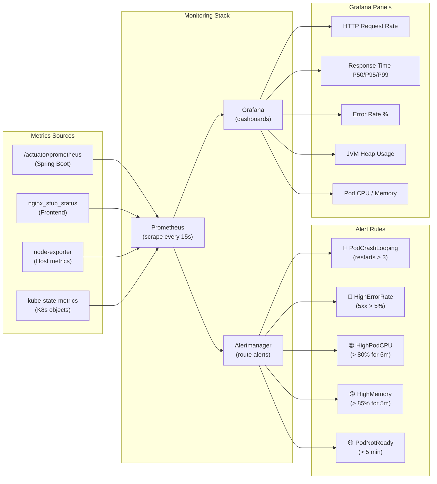
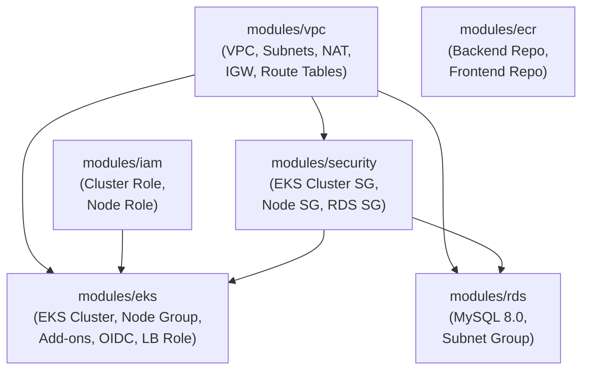
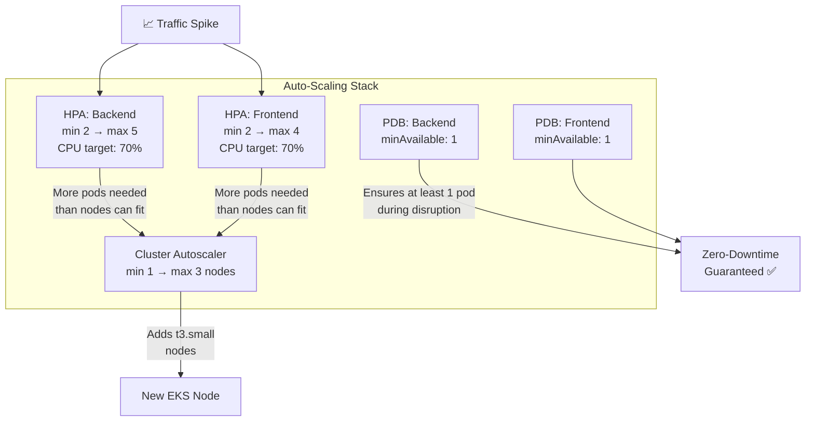

# 🚀 DC Music — Production DevOps Project Flow

> Complete end-to-end flow from code commit to production deployment on AWS EKS

---

## 📁 Project Structure Overview

```
Prod_DevOps/
│
├── frontend/                    ← React + Vite (Nginx Alpine)
│   ├── Dockerfile               ← Multi-stage build, security hardened
│   └── src/                     ← React components, Redux, Tailwind
│
├── backend/                     ← Spring Boot 3.2 (Java 17)
│   ├── Dockerfile               ← Multi-stage build, non-root user
│   ├── pom.xml                  ← Maven dependencies + Actuator
│   └── src/
│       └── main/resources/
│           ├── application.properties       ← Local (H2)
│           ├── application-aws.properties   ← AWS RDS profile
│           └── application-eks.properties   ← EKS profile (Actuator + Prometheus)
│
├── terraform/                   ← Infrastructure as Code
│   ├── modules/
│   │   ├── vpc/                 ← VPC + Subnets + NAT + EKS tags
│   │   ├── eks/                 ← EKS Cluster + Node Group + OIDC + ALB Role
│   │   ├── iam/                 ← Cluster IAM Role + Node IAM Role
│   │   ├── security/            ← EKS SG + Node SG + RDS SG
│   │   ├── ecr/                 ← Docker image repos (backend + frontend)
│   │   └── rds/                 ← MySQL 8.0 (encrypted, 7-day backups)
│   ├── main.tf                  ← Root — wires all modules
│   ├── variables.tf             ← All configurable inputs
│   ├── outputs.tf               ← EKS endpoint, kubeconfig cmd, RDS, ECR
│   └── provider.tf              ← AWS provider + S3 remote state
│
├── k8s/base/                    ← Raw Kubernetes Manifests
│   ├── namespace.yaml
│   ├── backend/                 ← Deployment, Service, HPA, ConfigMap, Secret
│   ├── frontend/                ← Deployment, Service, HPA, ConfigMap
│   ├── ingress.yaml             ← ALB Ingress (HTTP, no DNS)
│   ├── pdb-backend.yaml         ← Pod Disruption Budget
│   └── pdb-frontend.yaml
│
├── helm/dcmusic/                ← Helm Chart (templated K8s)
│   ├── Chart.yaml
│   ├── values.yaml              ← Default values
│   ├── values-dev.yaml          ← Dev overrides (small resources)
│   ├── values-prod.yaml         ← Prod overrides (HA, large resources)
│   └── templates/               ← 14 Helm templates
│
├── gitops/                      ← ArgoCD GitOps
│   ├── apps/
│   │   ├── dcmusic-dev.yaml     ← ArgoCD App (auto-sync)
│   │   └── dcmusic-prod.yaml    ← ArgoCD App (manual sync)
│   └── argocd/install.sh        ← ArgoCD installer script
│
├── monitoring/                  ← Observability Stack
│   ├── install.sh               ← kube-prometheus-stack installer
│   ├── prometheus/
│   │   ├── values.yaml          ← Prometheus + Grafana config
│   │   └── alerting-rules.yaml  ← Alert rules (CPU, crashes, errors)
│   └── grafana/
│       └── app-dashboard.json   ← Custom DC Music dashboard
│
├── Jenkinsfile                  ← CI/CD Pipeline (10 stages, EKS)
├── Jenkinsfile.infra            ← Infrastructure Pipeline (Terraform)
├── Makefile                     ← 15 developer shortcut commands
├── docker-compose.yml           ← Local development
└── PROJECT_FLOW.md              ← ⬅ THIS FILE
```

---

## 🔄 Complete End-to-End Flow



---

## 🏗️ AWS Infrastructure Architecture



---

## ⚙️ Jenkins CI Pipeline Flow (10 Stages)





---

## 🔄 ArgoCD GitOps Flow



---

## 📊 Monitoring Flow



---

## 🔧 Terraform Module Dependency Graph



---

## 🚀 Deployment Options

### Option A: Raw Kubernetes Manifests
```bash
# Quick deploy — direct kubectl
kubectl apply -f k8s/base/namespace.yaml
kubectl create secret generic dcmusic-db-secret \
  --from-literal=SPRING_DATASOURCE_URL="jdbc:mysql://RDS_ENDPOINT/dcmusic_db" \
  --from-literal=SPRING_DATASOURCE_USERNAME="admin" \
  --from-literal=SPRING_DATASOURCE_PASSWORD="YourPassword" \
  -n dcmusic
kubectl apply -f k8s/base/ -R
```

### Option B: Helm Chart (Recommended)
```bash
# Templated deploy — Helm
helm upgrade --install dcmusic helm/dcmusic \
  -f helm/dcmusic/values-dev.yaml \
  -n dcmusic --create-namespace \
  --set database.host=RDS_ENDPOINT
```

### Option C: ArgoCD GitOps (Production)
```bash
# Declarative deploy — ArgoCD watches Git
kubectl apply -f gitops/apps/dcmusic-dev.yaml
# ArgoCD auto-syncs from Helm chart in repo
```

---

## 🎯 Scaling Architecture



---

## 💰 Cost Breakdown (AWS Free Tier Account)

| Resource | Monthly Cost | Free Tier? |
|---|---|---|
| EKS Control Plane | ~$73 | ❌ No |
| 2× t3.small Nodes | ~$33 | ❌ No |
| NAT Gateway | ~$32 | ❌ No |
| ALB | ~$22 | ❌ No |
| RDS db.t3.micro | ~$0 | ✅ Yes (12 months) |
| ECR (500MB) | ~$0 | ✅ Yes |
| S3 (TF state) | ~$0.01 | ✅ Yes |
| **TOTAL** | **~$160/mo** | |

> **💡 Cost Saving Tips:**
> - Run `terraform destroy` when not using the cluster
> - Scale nodes to 0 during off-hours: `aws eks update-nodegroup-config --scaling-config minSize=0,desiredSize=0`
> - Use `make dev-up` for local Docker development (free) instead of EKS

---

## 🏃 Quick Start Commands (Makefile)

```bash
# Local Development (Free)
make dev-up              # Start with docker-compose
make dev-down            # Stop containers

# Infrastructure
make tf-init             # Initialize Terraform
make tf-plan             # Preview changes
make tf-apply            # Create AWS resources

# EKS Deployment
make eks-config          # Configure kubectl
make helm-dev            # Deploy to EKS (dev)
make helm-prod           # Deploy to EKS (prod)

# Monitoring & Tools
make argo-install        # Install ArgoCD
make mon-install         # Install Prometheus + Grafana

# Debugging
make status              # kubectl get all -n dcmusic
make logs-be             # Backend pod logs
make logs-fe             # Frontend pod logs
```

---

## 📋 Implementation Order

```
Step 1  → terraform init + apply          (create VPC, EKS, RDS, ECR, IAM)
Step 2  → aws eks update-kubeconfig       (configure kubectl)
Step 3  → Install AWS LB Controller       (enables ALB Ingress)
Step 4  → docker build + push to ECR      (push app images)
Step 5  → helm install dcmusic            (deploy app to EKS)
Step 6  → Verify: kubectl get ingress     (get ALB URL → access app)
Step 7  → Install ArgoCD                  (enable GitOps auto-deploy)
Step 8  → Install Prometheus + Grafana    (enable monitoring)
Step 9  → Configure Jenkins pipeline      (automate CI/CD)
Step 10 → Push code → watch it auto-deploy! 🎉
```

---

*For detailed step-by-step commands, see the [Implementation Guide](../../../.gemini/antigravity/brain/e2de5541-ba7d-483e-a928-7394fc0beabf/implementation-guide.md)*
