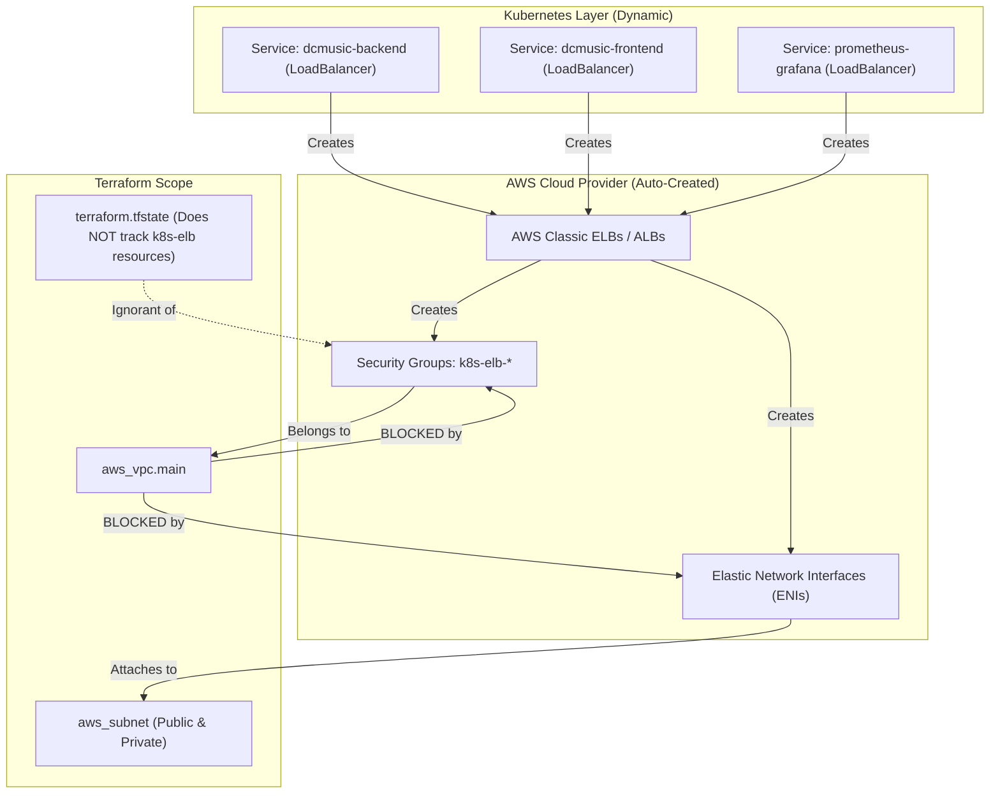

# 🧹 DC Music Infrastructure Teardown & Pre-Cleanup Guide

This guide details the complete teardown procedure for the **DCMusic** AWS infrastructure. It explains **why VPC deletions get stuck**, provides the **mandatory pre-destroy checklist**, and includes an **emergency runbook** if Terraform is already waiting on `aws_vpc.main: Still destroying...`.

---

## 📑 Table of Contents

1. [Why VPC Deletion Hangs (Root Cause Analysis)](#why-vpc-deletion-hangs-root-cause-analysis)
2. [Pre-Destroy Checklist (Run BEFORE Deletion)](#pre-destroy-checklist-run-before-deletion)
3. [Automated One-Click Pre-Cleanup Script](#automated-one-click-pre-cleanup-script)
4. [How Jenkinsfile.infra.delete Automates Teardown](#how-jenkinsfileinfradelete-automates-teardown)
5. [Emergency Runbook: If Terraform is Stuck on aws_vpc](#emergency-runbook-if-terraform-is-stuck-on-aws_vpc)
6. [Post-Destroy AWS Billing Verification](#post-destroy-aws-billing-verification)

---

## Why VPC Deletion Hangs (Root Cause Analysis)

AWS enforces strict dependency rules: **A VPC cannot be deleted while any subnet, Network Interface (ENI), or non-default Security Group exists within it.**



### The Conflict: Terraform vs. Kubernetes
1. **Terraform only deletes what is in `terraform.tfstate`:** Terraform provisions the VPC, Subnets, EKS cluster, and Node Group.
2. **Kubernetes creates resources outside Terraform:** When you deploy services of `type: LoadBalancer` (Backend, Frontend, Grafana), the AWS Cloud Controller in Kubernetes automatically generates:
   - AWS Classic Load Balancers (`ELBs`)
   - AWS Security Groups named `k8s-elb-<loadbalancer-id>`
   - Elastic Network Interfaces (`ENIs`) attached to the public subnets
3. **The Teardown Race Condition:** If you destroy the EKS cluster *before* deleting the Kubernetes services, the cluster disappears, but the AWS Load Balancers and `k8s-elb-*` Security Groups remain orphaned in AWS.
4. **The Result:** AWS rejects VPC deletion with:
   ```text
   DependencyViolation: The vpc 'vpc-xxxx' has dependencies (Security Groups / ENIs) and cannot be deleted.
   ```
   Terraform enters an infinite retry loop: `module.vpc.aws_vpc.main: Still destroying... [15m elapsed]`.

---

## Pre-Destroy Checklist (Run BEFORE Deletion)

Execute these steps **before** triggering `Jenkinsfile.infra.delete` or running `terraform destroy`:

### Step 1: Delete Kubernetes LoadBalancer Services
Deleting the Kubernetes services signals the cloud controller to cleanly de-provision the AWS ELBs and their auto-generated security groups:

```bash
# Delete all services in application and monitoring namespaces
kubectl delete svc --all -n dcmusic --timeout=90s || true
kubectl delete svc --all -n monitoring --timeout=90s || true
```

### Step 2: Terminate Any Manual Instances in the VPC Subnets
If you manually launched a Bastion/Jumper host or test EC2 instance inside the `dcmusic-vpc` subnets:
- Terminate the EC2 instance from the AWS Console or CLI.
- *(Note: If your jumper is in a different AWS account or the default VPC, this step is not needed).*

### Step 3: Verify Zero Lingering Resources
Run the pre-flight check to verify that no AWS resources are clinging to the VPC:

```bash
VPC_ID=$(aws ec2 describe-vpcs --filters "Name=tag:Name,Values=dcmusic-vpc" --query "Vpcs[0].VpcId" --output text --region ap-south-1)

# Verify 0 lingering Network Interfaces
aws ec2 describe-network-interfaces --filters Name=vpc-id,Values=$VPC_ID --region ap-south-1 --query 'NetworkInterfaces[*].[NetworkInterfaceId,Description]' --output table

# Verify 0 orphaned k8s Security Groups
aws ec2 describe-security-groups --filters Name=vpc-id,Values=$VPC_ID --region ap-south-1 --query 'SecurityGroups[?starts_with(GroupName, `k8s-elb`)].[GroupId,GroupName]' --output table
```

---

## Automated One-Click Pre-Cleanup Script

You can run this helper script on your jumper host or workstation before destroying infrastructure:

```bash
#!/usr/bin/env bash
# ==============================================================
#  scripts/pre-destroy-cleanup.sh — Safe Pre-Teardown Script
# ==============================================================
set -euo pipefail

REGION="ap-south-1"
CLUSTER_NAME="dcmusic-eks"

echo "🧹 Starting pre-destroy cleanup for ${CLUSTER_NAME}..."

# 1. Update Kubeconfig
if aws eks describe-cluster --name "$CLUSTER_NAME" --region "$REGION" >/dev/null 2>&1; then
    echo "🔧 Connecting to EKS cluster..."
    aws eks update-kubeconfig --name "$CLUSTER_NAME" --region "$REGION"

    echo "🗑️ Deleting Kubernetes LoadBalancers (releases AWS ELBs and SGs)..."
    kubectl delete svc -n dcmusic --all --timeout=60s || true
    kubectl delete svc -n monitoring --all --timeout=60s || true

    echo "⏳ Waiting 30s for AWS to de-register Load Balancer ENIs..."
    sleep 30
else
    echo "⚠️ Cluster ${CLUSTER_NAME} not found or already deleted. Skipping kubectl cleanup."
fi

# 2. Find VPC ID
VPC_ID=$(aws ec2 describe-vpcs --filters "Name=tag:Name,Values=dcmusic-vpc" --region "$REGION" --query "Vpcs[0].VpcId" --output text 2>/dev/null || echo "None")

if [ "$VPC_ID" != "None" ] && [ -n "$VPC_ID" ]; then
    echo "🔍 Cleaning up any orphaned k8s-elb Security Groups in ${VPC_ID}..."
    SG_IDS=$(aws ec2 describe-security-groups --filters Name=vpc-id,Values="$VPC_ID" --region "$REGION" --query 'SecurityGroups[?starts_with(GroupName, `k8s-elb`)].GroupId' --output text)

    for sg in $SG_IDS; do
        echo "   Deleting security group: $sg"
        aws ec2 revoke-security-group-ingress --group-id "$sg" --protocol -1 --source-group "$sg" --region "$REGION" 2>/dev/null || true
        aws ec2 delete-security-group --group-id "$sg" --region "$REGION" 2>/dev/null || true
    done
fi

echo "✅ Pre-destroy cleanup complete! Safe to run Jenkinsfile.infra.delete or terraform destroy."
```

---

## How Jenkinsfile.infra.delete Automates Teardown

In `Jenkinsfile.infra.delete`, this cleanup is automated in **Stage 6 (Terraform Destroy)**:

```groovy
stage('Terraform Destroy') {
    steps {
        withCredentials([...]) {
            // Step A: Clean up Kubernetes LoadBalancers so AWS ELB ENIs detach cleanly
            echo '🧹 Cleaning up Kubernetes LoadBalancers to release VPC subnets...'
            sh """
                aws eks update-kubeconfig --name ${EKS_CLUSTER_NAME} --region ${AWS_REGION} || true
                kubectl delete svc --all -n ${PROJECT_NAME} --timeout=60s || true
                kubectl delete svc --all -n monitoring --timeout=60s || true
            """

            // Step B: Terraform applies the destroy plan
            dir('terraform') {
                echo '💥 Destroying infrastructure...'
                sh 'terraform apply -auto-approve tfplan-destroy'
                echo '✅ All infrastructure has been destroyed.'
            }
        }
    }
}
```

---

## Emergency Runbook: If Terraform is Stuck on aws_vpc

If you triggered `terraform destroy` and it is **currently hanging** on:
```text
module.vpc.aws_vpc.main: Still destroying... [id=vpc-07d230ff66dc5a0a9, 14m00s elapsed]
```

**Do NOT press `Ctrl + C`!** Open a second terminal window (or AWS CloudShell) and run the following:

### Step 1: Diagnose the Exact Dependency
```bash
VPC="<YOUR_VPC_ID>" # e.g., vpc-07d230ff66dc5a0a9
REGION="ap-south-1"

# Check non-default Security Groups (Most Common Blocker)
aws ec2 describe-security-groups \
    --filters Name=vpc-id,Values=$VPC \
    --region $REGION \
    --query 'SecurityGroups[?GroupName!=`default`].[GroupId,GroupName]' \
    --output table

# Check active Network Interfaces (ENIs)
aws ec2 describe-network-interfaces \
    --filters Name=vpc-id,Values=$VPC \
    --region $REGION \
    --query 'NetworkInterfaces[*].[NetworkInterfaceId,InterfaceType,Description,Status]' \
    --output table
```

### Step 2: Delete Orphaned Security Groups Immediately
If the output shows security groups like `k8s-elb-*`:

```bash
# Auto-delete all non-default security groups in the stuck VPC
for sg in $(aws ec2 describe-security-groups --filters Name=vpc-id,Values=$VPC --region $REGION --query 'SecurityGroups[?GroupName!=`default`].GroupId' --output text); do
    echo "Revoking and deleting SG: $sg"
    aws ec2 revoke-security-group-ingress --group-id $sg --protocol -1 --source-group $sg --region $REGION 2>/dev/null || true
    aws ec2 delete-security-group --group-id $sg --region $REGION 2>/dev/null || true
done
```

### Step 3: Delete Lingering Classic ELBs (if any)
```bash
for elb in $(aws elb describe-load-balancers --region $REGION --query "LoadBalancerDescriptions[?VPCId=='$VPC'].LoadBalancerName" --output text); do
    echo "Deleting ELB: $elb"
    aws elb delete-load-balancer --load-balancer-name "$elb" --region $REGION
done
```

**Outcome:** Within 5–10 seconds of deleting the security groups/ELBs, the hanging Terraform process in your other terminal will print:
```text
module.vpc.aws_vpc.main: Destruction complete after 14m35s
Destroy complete! Resources: 38 destroyed.
```

---

## Post-Destroy AWS Billing Verification

After running the destroy pipeline, verify in the AWS CLI or AWS Console that zero chargeable resources remain:

```bash
REGION="ap-south-1"

echo "=== 1. Checking EKS Clusters (Target: None) ==="
aws eks list-clusters --region $REGION --output table

echo "=== 2. Checking EC2 Instances (Target: None or Terminated) ==="
aws ec2 describe-instances --region $REGION \
    --filters "Name=instance-state-name,Values=running,pending" \
    --query "Reservations[*].Instances[*].[InstanceId,InstanceType,Tags[?Key=='Name'].Value|[0]]" \
    --output table

echo "=== 3. Checking RDS Databases (Target: None) ==="
aws rds describe-db-instances --region $REGION --query "DBInstances[*].DBInstanceIdentifier" --output table

echo "=== 4. Checking NAT Gateways (Target: None or deleted) ==="
aws ec2 describe-nat-gateways --region $REGION --query "NatGateways[?State!='deleted'].[NatGatewayId,State]" --output table

echo "=== 5. Checking Elastic IPs (Target: None) ==="
aws ec2 describe-addresses --region $REGION --query "Addresses[*].[PublicIp,AllocationId]" --output table
```

*(Note: The Terraform S3 state bucket `dcmusic-tf-state-<ACCOUNT_ID>` is intentionally preserved so audit history and future deployments remain consistent).*
