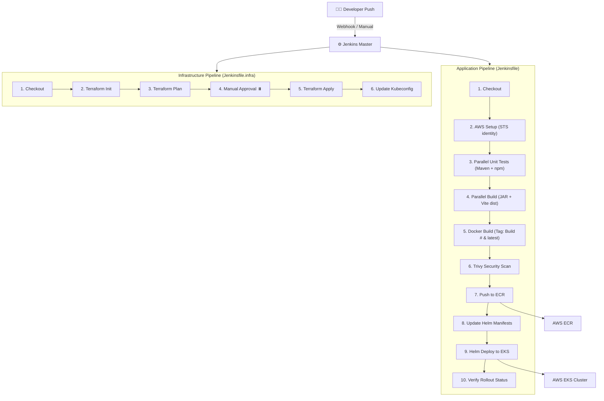

# 🛠️ Jenkins CI/CD Implementation Guide — DC Music on AWS EKS

> Comprehensive, dedicated guide for setting up, configuring, and operating the complete Jenkins CI/CD pipeline for **DC Music** deploying to **AWS EKS**.

---

## 📑 Table of Contents

1. [Architectural Overview](#1-architectural-overview)
2. [Jenkins Server Prerequisites & Installation](#2-jenkins-server-prerequisites--installation)
3. [Required Jenkins Plugins](#3-required-jenkins-plugins)
4. [Global Tool Configurations](#4-global-tool-configurations)
5. [Credentials Configuration](#5-credentials-configuration)
6. [Agent CLI Tools Setup & Permissions](#6-agent-cli-tools-setup--permissions)
7. [Application Pipeline Setup (`Jenkinsfile`)](#7-application-pipeline-setup-jenkinsfile)
8. [Infrastructure Pipeline Setup (`Jenkinsfile.infra`)](#8-infrastructure-pipeline-setup-jenkinsfileinfra)
9. [GitHub Webhook Integration (Automated Triggers)](#9-github-webhook-integration-automated-triggers)
10. [Pipeline Stages Deep Dive](#10-pipeline-stages-deep-dive)
11. [Troubleshooting & Maintenance](#11-troubleshooting--maintenance)

---

## 1. Architectural Overview

The Jenkins automation in this project consists of two dedicated pipelines:
1. **Application Pipeline (`Jenkinsfile`)**: 10-stage pipeline compiling Spring Boot & React, running security scans (Trivy), building and pushing Docker images to AWS ECR, and performing rolling deployments to AWS EKS via Helm / `kubectl`.
2. **Infrastructure Pipeline (`Jenkinsfile.infra`)**: 6-stage pipeline executing Terraform plan, requesting manual approval, applying changes to AWS resources, and updating Kubeconfig.



---

## 2. Jenkins Server Prerequisites & Installation

If you do not already have Jenkins running, install it using the steps below (Ubuntu 22.04 / 24.04 LTS):

```bash
# Update repository index
sudo apt update && sudo apt upgrade -y

# Install OpenJDK 17 (Jenkins runtime)
sudo apt install -y openjdk-17-jdk openjdk-17-jre fontconfig

# Add Jenkins repository GPG key and repo source
sudo wget -O /usr/share/keyrings/jenkins-keyring.asc \
  https://pkg.jenkins.io/debian-stable/jenkins.io-2023.key

echo "deb [signed-by=/usr/share/keyrings/jenkins-keyring.asc] \
  https://pkg.jenkins.io/debian-stable binary/" | sudo tee \
  /etc/apt/sources.list.d/jenkins.list > /dev/null

# Install Jenkins
sudo apt update
sudo apt install -y jenkins

# Enable and start service
sudo systemctl daemon-reload
sudo systemctl enable jenkins
sudo systemctl start jenkins

# Verify status
sudo systemctl status jenkins
```

### Initial Unlock
1. Open your browser: `http://<SERVER_IP>:8080`
2. Fetch the unlock password:
   ```bash
   sudo cat /var/lib/jenkins/secrets/initialAdminPassword
   ```
3. Choose **"Install suggested plugins"** and create your initial admin user.

---

## 3. Required Jenkins Plugins

Navigate to **Manage Jenkins** $\to$ **Plugins** $\to$ **Available plugins** and install the following:

| Plugin Name | Plugin ID | Purpose |
|---|---|---|
| **Pipeline** | `workflow-aggregator` | Core pipeline execution engine |
| **Pipeline: Stage View** | `pipeline-stage-view` | Visual stage matrix in Jenkins dashboard |
| **AWS Credentials** | `aws-credentials` | Manages AWS Access Key & Secret Key securely |
| **Docker Pipeline** | `docker-workflow` | Interacts with Docker daemon during pipeline stages |
| **NodeJS** | `nodejs` | Provides automated Node.js version management |
| **Kubernetes CLI** | `kubernetes-cli` | Enables `withKubeConfig` or native kubectl execution |
| **Credentials Binding** | `credentials-binding` | Injects passwords & tokens into shell environment |
| **Git** | `git` | Clones and inspects SCM repository code |

> Click **"Download now and install after restart"**, then tick the checkbox to restart Jenkins.

---

## 4. Global Tool Configurations

Go to **Manage Jenkins** $\to$ **Tools**.

### 4.1 — Maven Setup
1. Scroll to **Maven** section and click **Add Maven**.
2. **Name**: `Maven-3.9` *(Must match the tool name in Jenkinsfile)*.
3. Check **Install automatically**.
4. **Version**: `3.9.6` (or latest 3.9.x).

### 4.2 — NodeJS Setup
1. Scroll to **NodeJS** section and click **Add NodeJS**.
2. **Name**: `Node-20` *(Must match the tool name in Jenkinsfile)*.
3. Check **Install automatically**.
4. **Version**: `NodeJS 20.x` (e.g. `20.12.0` or higher).

Click **Save**.

---

## 5. Credentials Configuration

Navigate to **Manage Jenkins** $\to$ **Credentials** $\to$ **System** $\to$ **Global credentials (unrestricted)** $\to$ **Add Credentials**.

Create the following credentials:

### Credential 1: AWS Credentials
- **Kind**: `AWS Credentials`
- **Scope**: `Global`
- **ID**: `aws-credentials` *(Must match Jenkinsfile)*
- **Description**: `AWS Access Keys for EKS/ECR Deployment`
- **Access Key ID**: `<YOUR_AWS_ACCESS_KEY_ID>`
- **Secret Access Key**: `<YOUR_AWS_SECRET_ACCESS_KEY>`

### Credential 2: RDS Master Password
- **Kind**: `Secret text`
- **Scope**: `Global`
- **ID**: `rds-password` *(Must match Jenkinsfile)*
- **Description**: `RDS MySQL Root Password`
- **Secret**: `YourSecurePassword123!` *(Matches database password configured in Terraform)*

### Credential 3: GitHub Personal Access Token (Optional / GitOps Push)
- **Kind**: `Secret text`
- **Scope**: `Global`
- **ID**: `github-token`
- **Description**: `GitHub Token for updating Helm values in GitOps`
- **Secret**: `ghp_xxxxxxxxxxxxxxxxxxxx`

---

## 6. Agent CLI Tools Setup & Permissions

The host or agent executing Jenkins jobs must have specific binaries installed and user permissions granted to run Docker and Kubernetes commands.

### 6.1 — Docker Group Permission
The `jenkins` user must be allowed to communicate with the Docker daemon socket:
```bash
sudo usermod -aG docker jenkins
sudo systemctl restart jenkins
```

### 6.2 — Install AWS CLI v2
```bash
curl "https://awscli.amazonaws.com/awscli-exe-linux-x86_64.zip" -o "awscliv2.zip"
unzip awscliv2.zip
sudo ./aws/install
aws --version
```

### 6.3 — Install kubectl
```bash
curl -LO "https://dl.k8s.io/release/$(curl -L -s https://dl.k8s.io/release/stable.txt)/bin/linux/amd64/kubectl"
sudo install -o root -g root -m 0755 kubectl /usr/local/bin/kubectl
kubectl version --client
```

### 6.4 — Install Helm 3
```bash
curl https://raw.githubusercontent.com/helm/helm/main/scripts/get-helm-3 | bash
helm version
```

### 6.5 — Install Trivy
```bash
sudo apt-get install -y wget apt-transport-https gnupg lsb-release
wget -qO - https://aquasecurity.github.io/trivy-repo/deb/public.key | gpg --dearmor | sudo tee /usr/share/keyrings/trivy.gpg > /dev/null
echo "deb [signed-by=/usr/share/keyrings/trivy.gpg] https://aquasecurity.github.io/trivy-repo/deb $(lsb_release -sc) main" | sudo tee /etc/apt/sources.list.d/trivy.list
sudo apt-get update && sudo apt-get install -y trivy
trivy --version
```

### 6.6 — Verification as `jenkins` User
Verify that the `jenkins` user can access all commands cleanly:
```bash
sudo -u jenkins docker ps
sudo -u jenkins aws --version
sudo -u jenkins kubectl version --client
sudo -u jenkins helm version
sudo -u jenkins trivy --version
```

---

## 7. Application Pipeline Setup (`Jenkinsfile`)

### 7.1 — Create the Pipeline Job
1. In Jenkins Dashboard, click **New Item**.
2. Name: `dcmusic-app-ci`
3. Select **Pipeline** and click **OK**.
4. Configure Job:
   - **Build Triggers**: Check **GitHub hook trigger for GITScm polling**.
   - **Pipeline**:
     - **Definition**: `Pipeline script from SCM`
     - **SCM**: `Git`
     - **Repository URL**: `https://github.com/<YOUR_USER>/Prod_DevOps.git`
     - **Branch Specifier**: `*/main`
     - **Script Path**: `Jenkinsfile`
5. Click **Save**.

### 7.2 — Pipeline Script Configuration
The pipeline uses these global environment variables defined at the top of `Jenkinsfile`:
```groovy
environment {
    AWS_REGION       = 'ap-south-1'
    PROJECT_NAME     = 'dcmusic'
    EKS_CLUSTER_NAME = 'dcmusic-eks'
}
```
*(Ensure `AWS_REGION` and `EKS_CLUSTER_NAME` match your Terraform definitions).*

---

## 8. Infrastructure Pipeline Setup (`Jenkinsfile.infra`)

To decouple infrastructure changes from continuous code integration:

1. Click **New Item**.
2. Name: `dcmusic-infra-pipeline`
3. Select **Pipeline** and click **OK**.
4. Configure Job:
   - **Pipeline Definition**: `Pipeline script from SCM`
   - **Repository URL**: `https://github.com/<YOUR_USER>/Prod_DevOps.git`
   - **Script Path**: `Jenkinsfile.infra`
5. Click **Save**.

### Pipeline Stages in `Jenkinsfile.infra`:
1. **Checkout**: Clones repository.
2. **Terraform Init**: Connects to the AWS S3 backend and DynamoDB lock table.
3. **Terraform Plan**: Generates `tfplan`.
4. **Manual Approval**: Pauses pipeline with an interactive prompt (`Review Terraform Plan. Proceed?`).
5. **Terraform Apply**: Runs `terraform apply tfplan`.
6. **Update Kubeconfig**: Verifies and updates the local cluster configuration.

---

## 9. GitHub Webhook Integration (Automated Triggers)

To execute the pipeline on every `git push`:

1. Open your repository on GitHub.
2. Go to **Settings** $\to$ **Webhooks** $\to$ **Add webhook**.
3. **Payload URL**: `http://<JENKINS_PUBLIC_IP>:8080/github-webhook/` *(Trailing slash is mandatory)*.
4. **Content type**: `application/json`.
5. **Which events would you like to trigger this webhook?**: Select **Just the push event**.
6. Click **Add webhook**.

---

## 10. Pipeline Stages Deep Dive

Here is the exact runtime behavior of the 10 stages in `Jenkinsfile`:

| # | Stage | Execution Details |
|---|---|---|
| **1** | **Checkout** | Clones source code using `checkout scm`. |
| **2** | **AWS Setup** | Runs `aws sts get-caller-identity` to resolve account ID and sets `ECR_BACKEND` & `ECR_FRONTEND`. |
| **3** | **Unit Tests** | Runs parallel blocks: `mvn test` in `backend/` and `npm test` in `frontend/`. |
| **4** | **Build** | Runs parallel compilation: `mvn clean package -DskipTests` (Spring Boot JAR) and `npm run build` (Vite dist). |
| **5** | **Docker Build** | Builds multi-stage images, tagging them with `:latest` and `:${BUILD_NUMBER}`. |
| **6** | **Security Scan** | Runs `trivy image --exit-code 1 --severity CRITICAL` on both images. Flags unstable status on vulnerabilities. |
| **7** | **Push to ECR** | Authenticates via `aws ecr get-login-password` and pushes both build number and latest tags. |
| **8** | **Update K8s Manifests** | Updates image tags in `helm/dcmusic/values.yaml` via regex replacement (`sed`). |
| **9** | **Deploy to EKS** | Authenticates kubectl with `aws eks update-kubeconfig`, executes `helm upgrade --install`, and falls back to `kubectl set image` if needed. |
| **10** | **Verify Deployment** | Runs `kubectl rollout status` with a 300-second timeout to verify zero-downtime container transition. |

---

## 11. Troubleshooting & Maintenance

### Issue 1: `docker: permission denied while trying to connect to the Docker daemon`
- **Root Cause**: The `jenkins` user is not part of the `docker` system group.
- **Solution**:
  ```bash
  sudo usermod -aG docker jenkins
  sudo systemctl restart jenkins
  ```

### Issue 2: `aws: command not found` or `kubectl: command not found`
- **Root Cause**: Tools are installed in paths not included in Jenkins' system `PATH`.
- **Solution**: Ensure binaries exist in `/usr/local/bin` or `/usr/bin`. Verify Jenkins PATH under **Manage Jenkins** $\to$ **System** $\to$ **Environment variables** $\to$ `PATH` = `/usr/local/bin:/usr/bin:/bin:$PATH`.

### Issue 3: `error: You must be logged in to the server (Unauthorized)` on EKS Deploy
- **Root Cause**: The IAM credentials stored under `aws-credentials` do not have permissions in the EKS cluster's `aws-auth` ConfigMap or cluster access entries.
- **Solution**: Ensure the credentials match the IAM user/role that ran Terraform to create the cluster, or associate cluster administrator permissions in EKS.

### Issue 4: Disk Space Saturation
- Over time, Docker build layers and cache accumulate on the Jenkins server.
- The pipeline includes an `always` post-action:
  ```groovy
  always {
      sh 'docker image prune -f || true'
  }
  ```
- For manual cleanup:
  ```bash
  docker system prune -af --volumes
  ```

---

*Generated for DC Music CI/CD — Production AWS EKS Pipeline*
